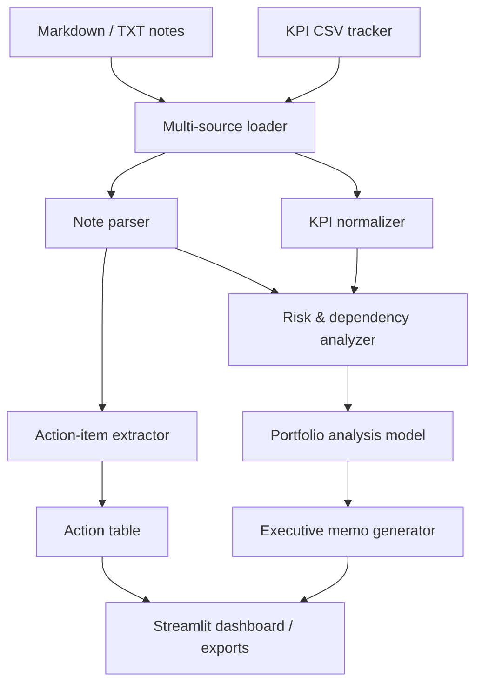

# Initiative-to-Decision Executive Brief Synthesizer

A hackathon-ready operations copilot that ingests weekly Markdown/text status notes and KPI CSVs, detects heuristic risk/dependency signals, extracts action items, and generates an executive decision memo.

## 1. What is included

- Streamlit user interface with upload support and sample workspace.
- Multi-source loader for `.md`, `.txt`, and `.csv`.
- Rule-based risk scoring for status, progress, blocker language, and resource/capacity pressure.
- KPI health checks with configurable direction (`higher` or `lower`).
- Dependency signal extraction.
- Action-item extraction for lines beginning `Action:`, `Next step:`, or `Decision needed:`.
- Executive memo generation with strategic options, trade-offs, decisions requested, and recommendations.
- Optional OpenAI narrative generation; deterministic fallback is always available.
- Six mock initiative notes, a multi-business-unit KPI tracker, and automated tests.

## 2. Architecture



### Component responsibilities

| Component | File | Responsibility |
|---|---|---|
| UI / orchestration | `app.py` | Uploads, user workflow, tables, downloads |
| Ingestion | `src/loader.py` | Reads notes and KPI CSVs; validates schema |
| Parsing | `src/parser.py` | Extracts initiative metadata from note headers |
| Risk engine | `src/analyzer.py` | Scores risks, checks KPI status, extracts dependencies |
| Actions | `src/actions.py` | Parses owners, deadlines, escalation flags |
| Memo | `src/memo.py` | Builds decision brief; optional LLM narrative |
| Export | `src/reporting.py` | Creates JSON-ready export object |
| Tests | `tests/test_core.py` | Smoke tests for loading, analysis, action extraction |

## 3. Prerequisites

- Python 3.10 or newer (Python 3.11 recommended)
- pip
- Optional: OpenAI API key for LLM-assisted narrative

## 4. Install and run (Windows PowerShell)

```powershell
# 1. Extract ZIP and enter project directory
cd initiative_decision_copilot

# 2. Create virtual environment
py -3.11 -m venv .venv

# 3. Activate it
.venv\\Scripts\\Activate.ps1

# 4. Install dependencies
python -m pip install --upgrade pip
pip install -r requirements.txt

# 5. Start the application
streamlit run app.py
```

Open the local URL printed by Streamlit (normally `http://localhost:8501`).

### macOS / Linux

```bash
cd initiative_decision_copilot
python3 -m venv .venv
source .venv/bin/activate
python -m pip install --upgrade pip
pip install -r requirements.txt
streamlit run app.py
```

## 5. Use the application

1. Start the app.
2. Leave the workspace folder as `data/sample` to use the six mock status notes and KPI tracker.
3. Click **Analyze workspace**.
4. Review portfolio health, risk register, and dependencies.
5. Open **Executive memo** and click **Generate executive memo**.
6. Open **Action items** to review extracted owners, deadlines, and escalation flags.
7. Download the memo, actions CSV, or portfolio analysis JSON.

To use your own data, upload all relevant `.md` / `.txt` status files and at least one KPI `.csv` in the uploader. Upload mode takes precedence over the folder path.

## 6. Input data contracts

### Status note format

Use one file per initiative per reporting week. The parser recognizes these metadata lines:

```text
# Initiative title
Initiative: Initiative title
Business unit: Business unit name
Owner: Full name or role
Status: On Track | At Risk | Delayed | Blocked
Progress: 0%
Target date: YYYY-MM-DD

Summary: ...
Blocker: ...
Dependency: ...
Resource note: ...

Action: Action description owner=Person due=YYYY-MM-DD
Next step: Action description owner=Person due=YYYY-MM-DD
Decision needed: Decision description owner=Role due=YYYY-MM-DD
```

Fields are case-insensitive. The `Initiative`, `Owner`, `Status`, and `Progress` lines are recommended. Missing values are marked `Unknown` or `0`.

### KPI CSV format

Required columns:

| Column | Type | Description |
|---|---|---|
| `initiative` | text | Initiative name; should match status note |
| `business_unit` | text | Business unit |
| `metric` | text | KPI name |
| `actual` | number | Latest measured value |
| `target` | number | Target value |
| `unit` | text | `%`, days, count, etc. |
| `direction` | optional text | `higher` (default) or `lower` |

Example:

```csv
initiative,business_unit,metric,actual,target,unit,direction
Initiative A,Operations,On-time delivery,91,95,%,higher
Initiative B,Finance,Days to close,7,5,days,lower
```

For lower-is-better metrics such as cycle time, include `direction=lower`.

## 7. Risk logic (transparent baseline)

The baseline is intentionally explainable and can be tuned in `src/analyzer.py`.

| Signal | Points |
|---|---:|
| Status is Blocked / At Risk / Critical / Delayed | +45 |
| Progress below 50% | +15 |
| Blocker / slippage / delay language found | +20 |
| Resource / capacity / staffing / bandwidth pressure | +15 |
| Maximum | 100 |

Risk bands:
- High: score >= 60
- Medium: score >= 30
- Low: score < 30

A risk record is created for an initiative when one or more note-based signals are found. Off-track KPI rows also create risk records. KPI severity is Medium unless the absolute variance exceeds 15% of target, in which case it is High.

**Important:** This is a demo heuristic, not a calibrated predictive model. Validate flags with initiative owners before taking action. For production, consider business-specific thresholds, trend history, confidence, and approved baselines.

## 8. Optional OpenAI setup

The app works without an API key. To enable LLM-assisted memo prose:

1. Copy `.env.example` to `.env`.
2. Add your key as `OPENAI_API_KEY=...`.
3. Export/load the environment variable before starting Streamlit. For PowerShell:

```powershell
$env:OPENAI_API_KEY="your-key"
streamlit run app.py
```

For macOS/Linux:

```bash
export OPENAI_API_KEY="your-key"
streamlit run app.py
```

4. In the sidebar, check **Use OpenAI for memo narrative**.

The risk engine and KPI calculations remain deterministic. Only memo wording is delegated to the model. Do not send confidential business information to an external model unless your organization has approved that data flow. Use a model name available to your API account.

## 9. Run tests

```bash
pytest -q
```

## 10. Docker

```bash
docker build -t initiative-decision-copilot .
docker run --rm -p 8501:8501 initiative-decision-copilot
```

Then open `http://localhost:8501`.

## 11. Known limitations / next increments

- The note parser expects explicit metadata labels and action-line syntax; it is not a general-purpose document understanding system.
- Date strings are extracted but not yet compared to the current date or milestone baseline.
- Dependency extraction is keyword-based; it does not yet resolve dependency graphs or calculate critical paths.
- KPI analysis currently compares one actual value with one target; it does not calculate trends or statistical anomalies.
- The demo treats each note as a separate initiative record; add initiative/week deduplication for longitudinal reporting.
- Production hardening should add authentication, audit logs, source citations per claim, role-based access, data retention controls, and human approval before distribution.

## 12. Suggested hackathon demo script (3–5 minutes)

1. Explain the problem: fragmented notes and metrics slow executive alignment.
2. Load the six sample notes and KPI tracker.
3. Show initiative health and the risk register.
4. Explain one high-risk signal and its underlying note text.
5. Show dependency signals and extracted actions with owners/deadlines.
6. Generate the executive memo and walk through options and trade-offs.
7. Export the memo and action CSV.
8. Close with the explainable baseline and production roadmap.

## 13. Troubleshooting

- **No notes found:** ensure `.md` or `.txt` files are in the selected folder or uploaded.
- **No KPI CSV found:** add at least one `.csv`.
- **Missing columns:** use the required KPI schema above.
- **Numeric conversion error:** remove commas/currency symbols from `actual` and `target`, or normalize before upload.
- **OpenAI narrative unavailable:** verify `OPENAI_API_KEY`, network access, package version, and model access; the deterministic memo fallback should still work.
- **PowerShell activation blocked:** run `Set-ExecutionPolicy -Scope Process -ExecutionPolicy Bypass`, then activate again.

## License

Provided as a hackathon starter project. Adapt and review before production use.
